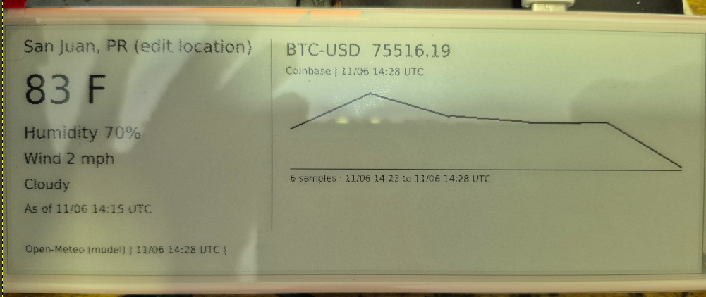

# CrowPanel Desk 🦀 📄

**Give your desk a tiny paper dashboard. Give Rust the controls.**

Send a note, put a chart beside your keyboard, keep the weather in view, or build a little display for whatever your next project needs. CrowPanel Desk is a base application stack for turning an **ELECROW CrowPanel 5.79-inch e-paper display** into something you can control from a browser, a terminal, or your own software.



*Real hardware. Real paper-like pixels. Plenty of room to experiment.*

The stack combines **Rust firmware, a Rust CLI, an Axum web server, and a vanilla JavaScript interface**. Start with USB, then bring the display onto Wi-Fi and power it from a separate USB adapter. The same renderer and delivery queue sit behind the web interface and API.

> **Project status:** working USB display and host application, with Wi-Fi hardware bring-up in progress. This is a foundation to build on, with its current limits documented below.

## What can it do?

| Feature | What you get |
| --- | --- |
| Messages | Multiline text, selectable font sizes, and rendered previews |
| Images | PNG, JPEG, GIF and WebP uploads, fitted and dithered for the panel |
| Charts | Line charts from your own numeric data |
| Weather | Outdoor temperature, relative humidity, wind and conditions from Open-Meteo |
| Tickers | Coinbase last-trade snapshots and a quote-ingestion API for other sources |
| Dashboards | A combined weather/ticker view with optional scheduled updates |
| Delivery | One queued update at a time, with completion or failure status |
| Transport | Working USB transfers and an authenticated TCP implementation for Wi-Fi |
| Integration | HTTP endpoints you can call from scripts, services, or other applications |

A build status board, a lab monitor, a family noticeboard, or a market dashboard all fit the same idea: **your software provides the content; this stack gets it onto the display.**

## The application stack

| Layer | Built with | Responsibility |
| --- | --- | --- |
| Browser interface | HTML, CSS, vanilla JavaScript | Compose content, inspect previews, configure feeds and track delivery |
| Local server | Rust, Axum, Tokio | HTTP API, feed polling, dashboard rendering and the delivery queue |
| Renderer and sender | Rust, image/imageproc, serialport, TCP | Prepare monochrome frames and transfer them to the board |
| Device firmware | Rust, esp-idf-hal, esp-idf-svc | USB/Wi-Fi reception, frame validation and display control |
| Display | ESP32-S3 + dual SSD1683 controllers | Drive the 792 × 272 black-and-white e-paper panel over SPI |

The host does the image rendering and feed integration. The ESP32 receives a finished frame, checks its CRC, updates the panel, and acknowledges completion. USB and Wi-Fi use the same frame format; Wi-Fi adds a shared-key authentication step.

The firmware is written in Rust on top of Espressif’s ESP-IDF runtime. There is no Arduino application to maintain. The web interface needs no frontend build tooling, and the server runs without a database service.

## Start here

You will need the CrowPanel board, a USB **data** cable, and a Linux development machine. The setup scripts target Ubuntu. The Python 3.11 flashing example assumes `pyenv` is installed. The board contains the ESP32 already; no separate controller is needed.

### First-time setup

From the cloned repository root:

```bash
bash scripts/setup-ubuntu.sh
source "$HOME/.cargo/env"
source "$HOME/export-esp.sh"

# Create local settings only if you do not already have them.
test -f .env || cp .env.example .env
```

For USB-only development, leave `EPAPER_WIFI_SSID` empty and keep `EPAPER_DEVICE_HOST` commented out in `.env`. For Wi-Fi, use the configuration and flashing instructions below.

Flash the firmware using the Python 3.11 procedure in the next section, then start the application:

```bash
bash scripts/web.sh
```

Open **[http://127.0.0.1:8787](http://127.0.0.1:8787)**. Select a content type, check its preview, and send it to the display.

### Already have the USB version working?

Update the project and run `bash scripts/web.sh`. Images, charts and host-side feeds work with the existing USB frame protocol. Enabling Wi-Fi requires the newer firmware and one USB flash.

### Your first API message

```bash
curl http://127.0.0.1:8787/api/messages \
  -H 'Content-Type: application/json' \
  -d '{"text":"Hello, paper!\nPowered by Rust.","size":40}'
```

The API returns a job ID immediately. The web interface shows whether the message is queued, sending, displayed, or failed.

## Find your way around

| Path | Contents |
| --- | --- |
| `firmware/` | ESP32 firmware, display driver, Wi-Fi receiver and partition table |
| `cli/` | Text/image renderer and USB/TCP sender |
| `web/src/` | Axum API, dashboard renderer, feed adapters and scheduler |
| `web/static/` | Browser interface embedded into the server binary |
| `web/tests/` | API smoke checks and mock-device integration checks |
| `scripts/` | Ubuntu setup, flashing and web-server launch scripts |
| `.env.example` | Example device credentials and runtime settings |
| `Dockerfile`, `compose.yaml` | Optional Linux deployment for an always-on host |
| `image.jpg` | The project photograph shown above |

## Enable Wi-Fi delivery

### 1. Configure the board

```bash
test -f .env || cp .env.example .env
python3 -c 'import secrets; print(secrets.token_hex(24))'
```

Edit `.env` with your 2.4 GHz SSID/password and the generated `EPAPER_DEVICE_KEY`. Leave `EPAPER_DEVICE_HOST` commented out for now. Keys must contain 16–128 ASCII letters or digits. Wi-Fi credentials and the device key are compiled into the firmware; changing them requires reflashing. They are never sent to the frontend.

From the repository root, build and flash using Python 3.11. Export the project settings explicitly so Cargo can embed the Wi-Fi credentials:

```bash
pyenv install -s 3.11
(
  export PYENV_VERSION="$(pyenv latest 3.11)"
  export PYTHONNOUSERSITE=1
  unset PYTHONPATH PYTHONHOME VIRTUAL_ENV
  unset PIP_TARGET PIP_PREFIX PIP_USER
  source "$HOME/.cargo/env"

  set -a
  source .env
  set +a

  bash scripts/flash.sh
)
```

If the board does not enter download mode: hold BOOT, tap RESET, release BOOT, retry. The flash script installs a 6 MiB factory app partition on the board’s 8 MiB flash to leave room for networking. No OTA partition is configured. Existing USB image transfers remain supported. The Wi-Fi thread reconnects after loss of connection; USB runs independently if the access point is unavailable.

### 2. Find the board address

After a successful connection, the firmware prints `WIFI 192.168.x.x:7878` over USB serial. To see it:

```bash
espflash monitor --port /dev/serial/by-id/usb-1a86_USB_Serial-if00-port0
```

Press **Ctrl+R** or tap RESET after opening the monitor. Close the monitor before using the sender. The router's connected-device list is another way to find the ESP32 address. A DHCP reservation in your router keeps it stable.

Uncomment and edit this line in `.env`:

```bash
EPAPER_DEVICE_HOST='192.168.1.50:7878'
```

Restart `bash scripts/web.sh`. The sender now targets that Wi-Fi address. Test an update while USB is still attached, then move the display to a USB wall adapter or suitable USB power bank. It no longer needs a laptop data cable. Battery-connector operation/charging and low-power sleep are not part of this release; Wi-Fi remains awake.

The TCP frame protocol requires the shared key before accepting an image. It is intended for a trusted LAN; it is not an encrypted internet-facing service.

### 3. Where the server runs

The server gathers feeds and renders images, then pushes them to the display. It must remain running for new updates. If it stops, e-paper retains the last image and its printed timestamps.

| Arrangement | What runs |
| --- | --- |
| USB development | Laptop server + USB connection |
| Wi-Fi display | Laptop server + display on a USB power adapter |
| Updates while laptop is off | Server on an always-on Linux machine + Wi-Fi display |

For an always-on Linux machine with Docker, copy the project and `.env`, set the Wi-Fi address/key, and run:

```bash
mkdir -p data
docker compose up -d --build
```

The container uses Linux host networking so the local web UI remains on loopback at `127.0.0.1:8787`. Open a browser on that machine, or tunnel it from your laptop:

```bash
ssh -L 8787:127.0.0.1:8787 user@your-server
```

Then browse http://127.0.0.1:8787 on your laptop. Config persists in `./data/dashboard.json`. No PostgreSQL, Redis or external frontend tools are needed for this small service. The Docker deployment is provided but has not yet been verified on hardware.

## Weather and ticker feeds

Expand **Dashboard feeds & automatic updates** in the web UI:

- Set your location label and coordinates. The initial coordinates are San Juan, Puerto Rico; edit them for your actual location.
- Enable Open-Meteo for temperature (F), relative humidity (%), wind (mph), and weather condition. These are modelled outdoor conditions, not a sensor inside your room. Fetched every 10 minutes.
- Add Coinbase product IDs such as `BTC-USD, ETH-USD`. Last-trade snapshots are polled every 60 seconds; this is not a tick-by-tick stream.
- Preview/send the dashboard manually, or enable scheduled display updates (default 300 seconds, minimum 120 seconds).

The full-refresh driver flashes during updates. Feed polling and physical display cadence are intentionally separate. Scheduled frames do not pile up while another delivery is active. Scheduled mode replaces manual messages when the next dashboard update is due; disable it to leave a manual image on screen.

Ticker charts accumulate up to 120 timestamped samples per source/symbol in memory. Source timestamps are preserved; quotes older than 120 seconds and weather older than 30 minutes are labelled STALE. Failed fetches preserve old values and show a FEED ERROR. The screen's printed timestamps remain fixed if the server goes offline. Snapshot and job histories reset on server restart; settings persist. The first sorted source/symbol gets the chart, followed by two ticker rows. The JSON API retains up to 12 source/symbol pairs.

Sources: https://open-meteo.com/en/docs and https://docs.cdp.coinbase.com/api-reference/exchange-api/rest-api/products/get-product-ticker . Observe each provider's usage terms. No API keys are required by these built-in endpoints. The adapters preserve the timestamps supplied by each source.

## HTTP API

The web API binds only to `127.0.0.1`. Browser requests from another origin are rejected. Existing text endpoints remain compatible.

### Text

```bash
curl http://127.0.0.1:8787/api/messages \
  -H 'Content-Type: application/json' \
  -d '{"text":"Hello, Jake","size":40}'
```

### Image

```bash
curl http://127.0.0.1:8787/api/images -F 'file=@picture.png'
curl 'http://127.0.0.1:8787/api/images?preview=true' -F 'file=@picture.png' -o preview.png
```

Images: PNG/JPEG/WebP/GIF, at most 4 MiB and 4096 × 4096; GIF uses the decoded first image. Every image is resized and converted to the display's monochrome frame.

### Chart

```bash
curl http://127.0.0.1:8787/api/charts \
  -H 'Content-Type: application/json' \
  -d '{"title":"Temperature","unit":"F","values":[80,82,81,84,83]}'
```

Add `?preview=true` to receive a PNG instead of queueing a display update.

### Bring your own ticker source

A stock, futures or crypto adapter can POST prices to the server. Provider credentials stay with your adapter:

```bash
curl http://127.0.0.1:8787/api/quotes \
  -H 'Content-Type: application/json' \
  -d "{\"symbol\":\"SPY\",\"price\":500.25,\"source\":\"my-feed\",\"timestamp\":$(date +%s)}"
```

That price is an illustrative payload, not a market quote. Supply the actual source's Unix timestamp in seconds; do not stamp delayed data with the time of receipt. Prices must be finite and positive. Out-of-order samples, future timestamps beyond 60 seconds, and conflicting values at an identical timestamp are rejected. Same-time/same-price repeats are deduplicated.

The quote-ingestion endpoint caches data; it does not send a frame immediately. Enable scheduled dashboards or call:

```bash
curl -X POST http://127.0.0.1:8787/api/dashboard/frame
curl 'http://127.0.0.1:8787/api/dashboard/frame?preview=true' -o dashboard.png
```

| Endpoint | Purpose |
| --- | --- |
| GET /api/status | Transport configuration, serial path presence, queue availability |
| POST /api/messages | Queue text (size 12–96) |
| POST /api/preview | Text preview PNG |
| POST /api/images | Queue multipart image; `?preview=true` for PNG |
| POST /api/charts | Queue JSON line chart; `?preview=true` for PNG |
| POST /api/quotes | Ingest source/symbol/price/timestamp |
| GET /api/dashboard | Cached weather, ticker samples, source errors |
| GET or POST /api/dashboard/frame | Queue dashboard; `?preview=true` for PNG |
| GET or PUT /api/config | Get/save dashboard feed settings |
| GET /api/messages | Latest 100 delivery jobs |
| GET /api/messages/{id} | Specific job status/error |

Queue responses are HTTP 202 with job IDs. Completion states are `displayed`, `failed`, or `simulated`; `displayed` requires the firmware's DONE acknowledgement. The web status shows the configured transport, not a Wi-Fi health probe. A configured IP can be unreachable; job errors report that. Eight waiting jobs plus one active delivery are allowed. Errors are not automatically retried because a physical refresh may have occurred before a timeout. No guarantees of persistence are made for jobs across restart.

## When the paper stays quiet

| Symptom | Check |
| --- | --- |
| Connection timeout after enabling Wi-Fi | Verify the actual board IP and port `7878`; a configured address is not a connection check |
| Only `BOOT crowpanel-rust` appears | Confirm the Wi-Fi settings were exported **before compilation**; inspect connection diagnostics if it continues |
| USB worked before setting a device host | Comment out `EPAPER_DEVICE_HOST`, run `unset EPAPER_DEVICE_HOST`, then restart the web server |
| Serial port is busy | Close `espflash monitor` and other serial applications before sending |
| Python dependency check fails | Use the Python 3.11 build command above; inspect the Python path in the error before changing unrelated packages |
| Image flashes during refresh | Expected for the current full-refresh driver |

`source "$HOME/.cargo/env"` loads Rust tools into your shell. `source .env` loads the project settings from your current directory. The `set -a` block in the flash command exports those settings to Cargo. They serve different purposes.

## Runtime options

Settings are shell assignments in `.env`, loaded by `scripts/web.sh` and `scripts/flash.sh`:

- `EPAPER_DEVICE_HOST`: `IP:7878`; absent means USB.
- `EPAPER_DEVICE_KEY`: shared Wi-Fi key; compiled into firmware and supplied to the sender at runtime.
- `EPAPER_PORT`: alternative serial device path.
- `EPAPER_HTTP_PORT`: local web port, default 8787.
- `EPAPER_CONFIG`: settings file, default `data/dashboard.json`.
- `EPAPER_DRY_RUN=1`: render and simulate delivery without contacting USB or Wi-Fi.
- `EPAPER_BIN`: custom sender binary when running the web executable directly.
- `EPAPER_FONT`: font for server-rendered charts/dashboard (defaults to DejaVu Sans).

## Development and checks

USB text display has been exercised on the physical board. The host sender/server compile, the mock TCP transfer checks pass, and both built-in feed adapters have returned live data. **Physical Wi-Fi delivery is still being brought up.** A successful flash or `BOOT crowpanel-rust` message alone does not confirm Wi-Fi connectivity. Docker deployment and browser layout verification remain open checks.

```bash
cargo test --manifest-path cli/Cargo.toml
cargo test --manifest-path web/Cargo.toml
cargo build --manifest-path cli/Cargo.toml
cargo build --manifest-path web/Cargo.toml
python3 web/tests/integration.py
```

The Python integration check requires Pillow. It starts its own mock TCP display and server on temporary local ports, then checks key authentication, frame size/CRC, chunk acknowledgements, text/chart/dashboard queue completion, image preview, invalid quotes and config writes. It never contacts physical hardware. `web/tests/smoke.py` additionally checks a separately running default-port simulation server.

Hardware: ESP32-S3-WROOM-1-N8R8, dual SSD1683. GPIO power7, SCK12, MOSI11, CS45, DC46, RESET47, BUSY48. The 792 × 272 visible image maps to an 800 × 272 buffer with eight padding columns at x=396. The display command sequence follows [ELECROW’s reference implementation](https://github.com/Elecrow-RD/CrowPanel-ESP32-5.79-E-paper-HMI-Display-with-272-792).

## Where this can go next

The useful part of this project is the base stack: a device driver, a renderer, a delivery protocol, and an API you can extend.

Possible next steps, **not implemented yet**:

- More feed adapters and selectable dashboard layouts.
- Hardware SPI and carefully tested partial-refresh support.
- Persistent history and saved dashboard presets.
- On-device Wi-Fi provisioning and richer connection diagnostics.
- Battery operation, sleep scheduling and power measurements.
- OTA firmware updates.

## Contributing

Small, practical improvements are welcome: a new data adapter, a clearer dashboard, a reproducible bug report, or a tested device-driver improvement. Include your board revision and transport when reporting hardware behaviour, and distinguish a mock-device test from a physical-panel test.

Keep real Wi-Fi passwords and device keys in your local `.env`; use placeholders in examples. The repository ignores `.env`, generated build output and local dashboard data.

## Hardware credit

Built around ELECROW’s CrowPanel hardware and reference display sequence, with the Rust ESP32 ecosystem providing the device tooling and bindings. The project photograph is referenced as `./image.jpg`; keep that file beside this README so GitHub can render it.
